# agy-capsule

[中文](./README.md) | **English**

Context usage, multi-model quotas, cache status and generation speed in the Antigravity composer footer. Hover a capsule to see the details.

  

- [Features](#features)
- [Appearance](#appearance)
- [Settings](#settings)
- [Installation](#installation)
- [Metric definitions](#metric-definitions)
- [Notices](#notices)

## Features

### Context and generation metrics

See at a glance how full the context is, what it is full of, and how fast the latest request generated.

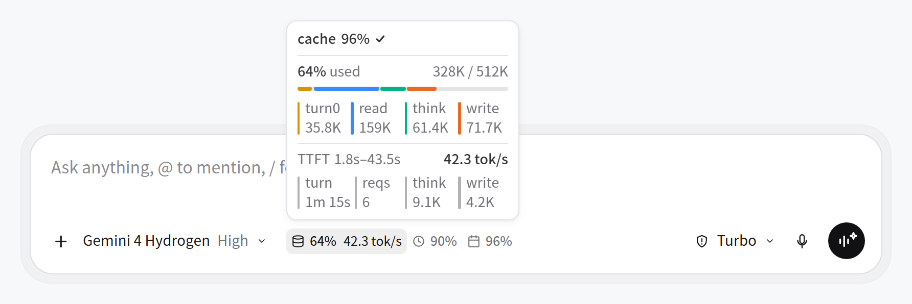

The limit is read live for the current session and model (e.g. 256K / 512K); before the first turn it shows 0 / --. The breakdown is turn0 (first turn), read, think and write. Latest request shows effective speed, time to first token (TTFT) and request duration; turn metrics count from your latest message. See <a href="#metric-definitions">Metric definitions</a>.

### Multi-model quotas

Remaining 5-hour and weekly quota for every model group, and how long until each resets.

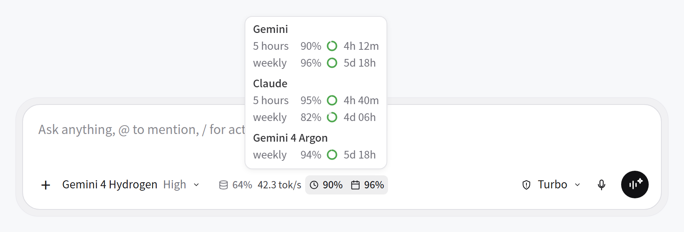

The capsule follows the model selected in the footer. Hover a row for the exact reset date, time and timezone.

### Cache expiry alerts

Turns yellow with a countdown before the cache expires and red after, so you can follow up while it is still warm.

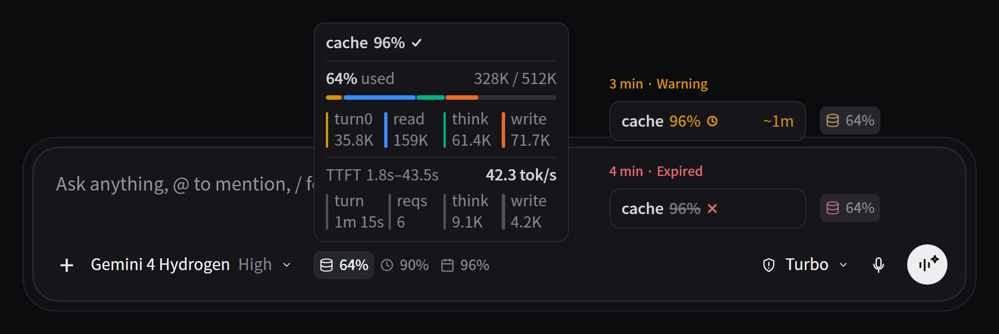

Yellow with a countdown (~1m) three minutes after the last turn, red at four. A local time-based estimate; actual cache hits depend on the server.

### Request failures

Tells you why a request failed, without digging through logs.

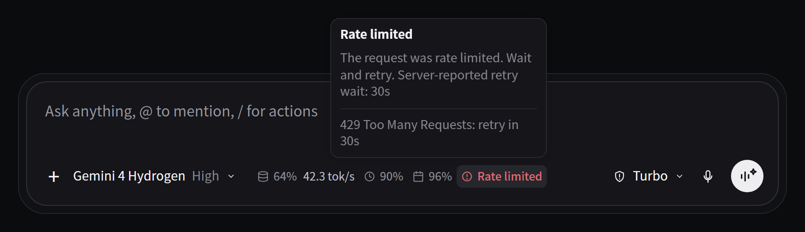

Distinguishes quota exhaustion, 429 rate limits, network drops, authentication problems, busy services and unknown errors, with the raw error in the panel. Stopping generation yourself is not a failure and shows nothing.

### Narrow-footer folding

Stays tidy in narrow windows, keeping the most important information longest.

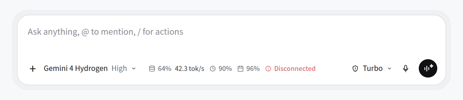

The Turbo selector folds to its icon first, then speed, failure text and quota numbers fold and the model name shortens, keeping the context and failure entry points visible. Widening restores everything.

### Also

- **Click to pin**: Click a capsule and its panel stays open.
- **Warning colors**: The capsule number turns yellow, then red, as the context fills up.
- **Light and dark themes**, **translation-safe**, **no client changes**.

Click again, click outside or press Esc to close a pinned panel. Context warnings trigger at 75% (yellow) and 90% (red) and can be turned off. The context panel aligns to the footer's left edge; quota and failure panels sit as far left as possible while covering their own capsule; in narrow footers, panels stay inside the composer instead of being clipped. Colors come from Antigravity's own variables. Numbers and countdowns are marked do-not-translate so translation extensions cannot misalign them. The plugin mounts through a native Sidecar and CDP with styles isolated in Shadow DOM, so it keeps working after client updates.

## Appearance

Every option below is independent. Change them on the sidebar's Settings tab; changes apply immediately with a live preview.

### Breakdown layout: columns or rows

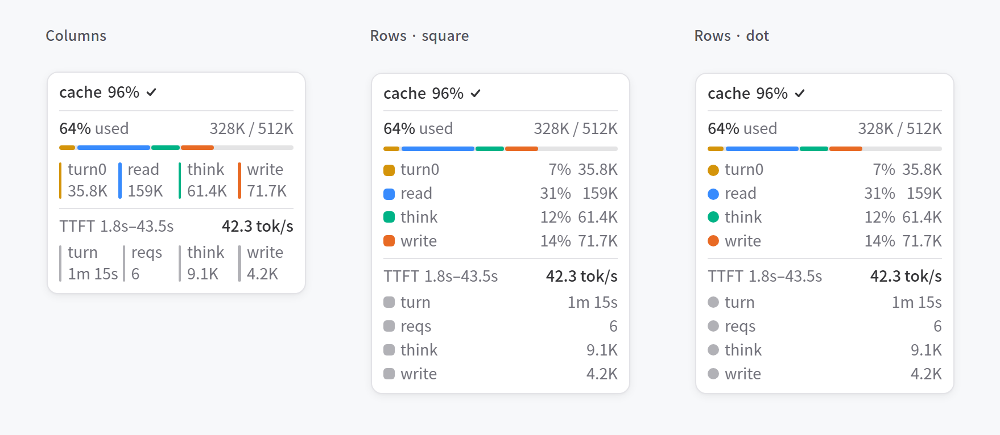

The context breakdown and turn metrics each choose columns (four side by side) or rows (one per line). In rows mode, each also picks its own marker (square or dot). The context breakdown can be turned off entirely.

### Which fields columns show

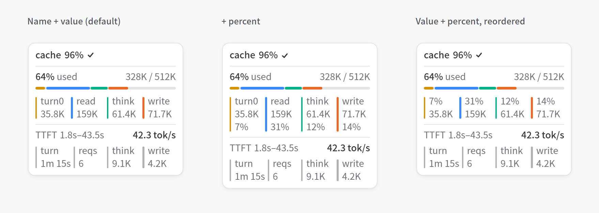

In columns mode, name, value and percent can each be turned on or off and dragged into any order (see [Settings](#settings)).

### Quota panel: indicator, countdown and language

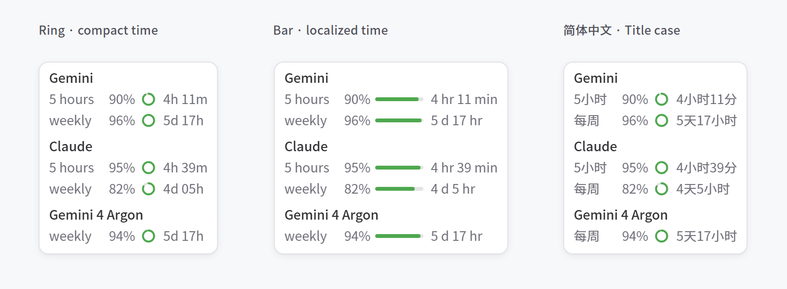

- **Quota indicator**: Ring or bar.
- **Reset countdown**: Compact (`4h 55m`) or localized to the display language (`4 hr 55 min`, `4小时55分`).
- **Label casing**: Lowercase (`weekly`) or title case (`Weekly`).
- **Display language**: English, Simplified Chinese or Traditional Chinese.

### Panel height

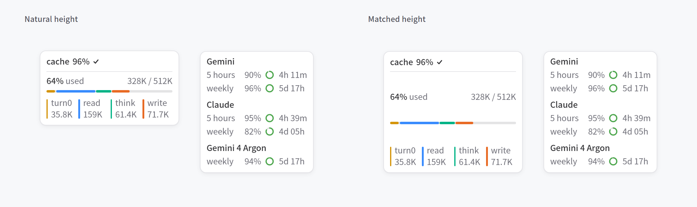

Natural: each panel is as tall as its content. Matched: context, quota and failure panels share one height, so switching between them doesn't jump.

### Panel spacing

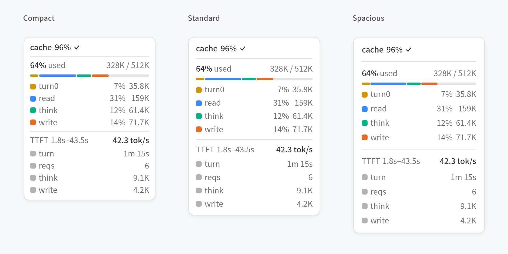

Compact, standard or spacious.

## Settings

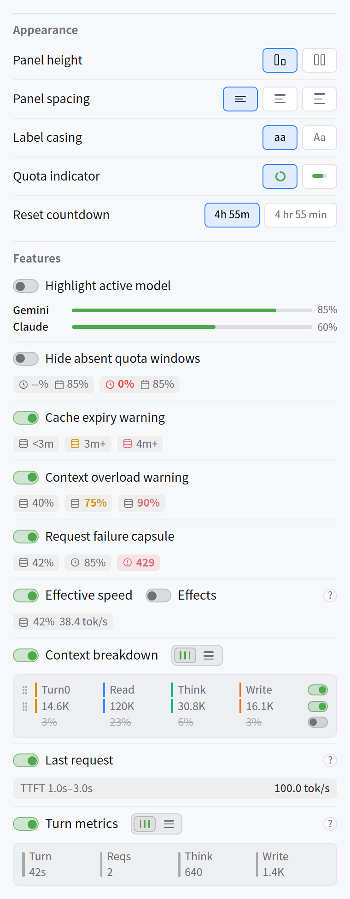

Open **… → Extensions → agy-capsule** from the conversation header, then switch between the Statistics and Settings tabs at the top.

| Setting | Default | What it does |
|---|---|---|
| Display language | English | Language of footer panels and sidebar statistics |
| Settings language | Simplified Chinese | Language of the settings page itself |
| Highlight active model | Off | Marks the current model's group in the quota panel |
| Hide absent quota windows | Off | When only 5h or only weekly data exists, hide the empty placeholder |
| Cache expiry warning | On | Yellow at 3 minutes, red at 4 |
| Context overload warning | On | Yellow at 75% usage, red at 90% |
| Request failure capsule | On | Shows a third capsule when a request fails |
| Effective speed / Effects | On / Off | Speed in the footer; effects make the dot breathe while generating |
| Context breakdown | On | The four-part breakdown in the context panel |
| Last request | On | Speed, TTFT and request duration |
| Turn metrics | On | Turn time, requests, thinking and write tokens |

 

Edit column fields right in the preview: the switch on the right shows or hides a row (hidden rows gray out and move to the bottom), and the handle on the left drags rows into a new order.

  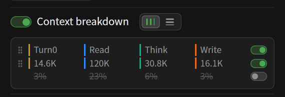

Preferences live in <code>~/.gemini/config/agy-capsule/settings.json</code> (<code>%USERPROFILE%\.gemini\config\agy-capsule\settings.json</code> on Windows), outside the plugin directory, so updates and uninstalls keep them. Options missing from older files fall back to defaults.

## Installation

1. Download or pull this repository, then run the appropriate script:

   | Action | Windows | macOS / Linux |
   |---|---|---|
   | Install | `install.bat` | `sh install.sh` |
   | Update | `update.bat` (pull the latest code first) | `sh update.sh` (pull the latest code first) |
   | Uninstall | `uninstall.bat` | `sh uninstall.sh` |

   Installation/updates sync to <code>~/.gemini/config/plugins/agy-capsule</code> (<code>%USERPROFILE%\.gemini\config\plugins\agy-capsule</code> on Windows), removing stale plugin files. Uninstall removes the plugin directory but keeps preferences.
2. Enable **agy-capsule** in Antigravity's **Plugins** panel.
3. Open **… → Extensions → agy-capsule** from the conversation header.

The UI prefers Source Han Sans and falls back to the system font; nothing extra to download.

### Automatic reload

The running plugin checks its installed code/configuration every second. Once changes settle for about 1.5 seconds, it cleans up its injected UI and exits so AGY can restart it and reconnect open sidebars. The installer holds a marker to prevent restarts during a copy. This does not restart AGY, resend chat requests, or copy files from the repository automatically.

The first update from an older version without automatic reload needs one manual plugin restart. After uninstalling, reload any open page that still shows the old UI. Scripts do not modify the host installation. Copying the [`agy-capsule`](./agy-capsule) folder manually also remains supported.

## Metric definitions

- **Effective speed** = total output ÷ (TTFT + streaming time). It includes the wait for the first token, so it is not a pure streaming rate.
- **Latest request** covers only the most recent model request, not the whole turn; missing values show `—` rather than borrowing older ones.
- **Turn metrics** start at your latest message; elapsed time includes queueing, waiting and tools.
- **Cache expiry** is a local time-based estimate, not the server's actual cache state.

Details

#### Latest request

- **Scope**: The latest model request's metadata, not the entire user turn. Missing values remain unknown rather than borrowing older measurements.
- **Output**: `usage.outputTokens` is total output = response (including tool calls) + thinking. The four-part context breakdown keeps its existing accounting.
- **TTFT / duration**: AGY's recorded `timeToFirstToken` and `streamingDuration`; request duration is their sum and excludes tool execution. TTFT's exact timer start, source and first-token boundary are unverified; it is not a prefill-only measurement.
- **Speed**: `total output ÷ (TTFT + streamingDuration)`, an effective throughput. Incomplete or zero timings produce no speed.
- **Footer speed**: Scoped to the turn started by your latest message; shows `—` until a request completes, then keeps this turn's latest completed result. With effects on, the dot breathes while the turn runs (including tools), keeps its color for 15 seconds after stopping, then grays out. Red below 10 tok/s, yellow from 10 to under 25, green at 25+.
- **Cross-check**: Counts and timings for 22 local Gemini Hydrogen/Argon requests matched Language Server RPC. The plugin reads SQLite and does no RPC polling.

#### Turn metrics

- Starts at the latest sent user message, including queueing; each new message resets the totals.
- Requests include recorded retries, excluding pure preflight and injected responses. Steps are not requests, and unrecorded backend calls are not claimed to be covered.
- Thinking and write totals sum each request's reported usage. Write covers responses/tool-call instructions, not thinking or tool results, and differs from the context breakdown's write.
- Elapsed time uses wall-clock boundaries, including waits and tools, never summed request durations. It advances locally while running and freezes at a known end. Missing cancellation timestamps remain unknown.
- Missing usage makes the affected total `—`; hover shows the recorded subtotal. A conversation without a user message hides the block.

#### Cache

- The Cache row shows cached input as a share of total input, plus how long ago the latest record was (`<1m`, `5m`, `1h 5m`). This is record age, not remaining cache lifetime.

#### Implementation

- Database reads are reused until the DB/WAL changes. Renderer code installs once and receives changed data only, while local clocks keep refreshing.
- Native Turbo/model-name folding uses footer-scoped runtime styles only, without modifying host files or button behavior.

## Notices

- Many features in this version come from [z21100644's PR #1](https://github.com/Lumidarin/agy-capsule/pull/1), picked item by item and reimplemented rather than merged as a whole: multiple languages, parts of the panel visual design, active-model highlighting, click-to-pin, generation metrics and speed effects, Cache and quota tooltips, usage warnings and error classification, absent quota-window hiding, plus ideas for style isolation, cached reads, incremental CDP pushes and install maintenance. Separate display/settings languages, independent appearance controls, the third failure capsule, folding priority, turn metrics and the later sidebar interactions were designed separately. Seven-category context estimates and attachment scanning were not adopted.
- The quota popover overflow under page-translation extensions was reported, with a proposed fix, in [Krwaby123's PR #2](https://github.com/Lumidarin/agy-capsule/pull/2). This version solves it with column alignment and do-not-translate markers instead of merging that PR directly.
- Images and GIFs in this README are rendered from the plugin's real code with demo data, not from a live session.
- Currently tested only on **Windows**. Testing, feedback and PRs on **macOS** are very welcome!

## License

[MIT](./LICENSE)
