# agy-capsule

**中文** | [English](./README.en.md)

在 Antigravity 输入框底栏显示上下文占用、多模型配额、缓存状态和生成速度，悬停胶囊即可查看详情。

  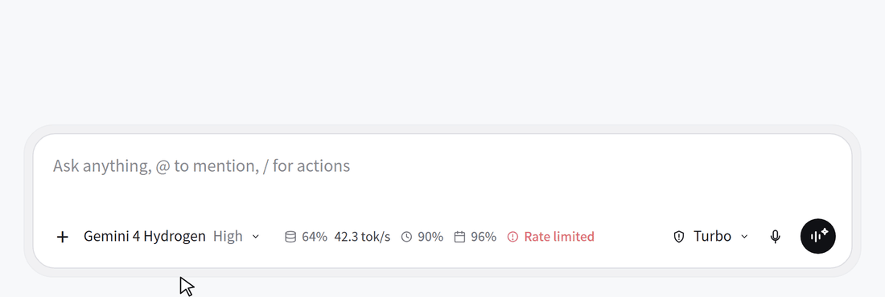

- [上下文胶囊](#上下文胶囊)
- [上下文面板](#上下文面板)
- [配额胶囊与面板](#配额胶囊与面板)
- [报错胶囊](#报错胶囊)
- [多语言](#多语言)
- [其他](#其他)
- [设置](#设置)
- [安装](#安装)
- [数据口径](#数据口径)
- [声明](#声明)

## 上下文胶囊

底栏第一个胶囊：一眼看出上下文用了多少、缓存还在不在，以及最近一次生成得多快。

- **缓存提醒**：缓存快过期时变黄倒计时，过期后变红，新一轮对话后恢复正常；面板里的 Cache 行同步变化。

  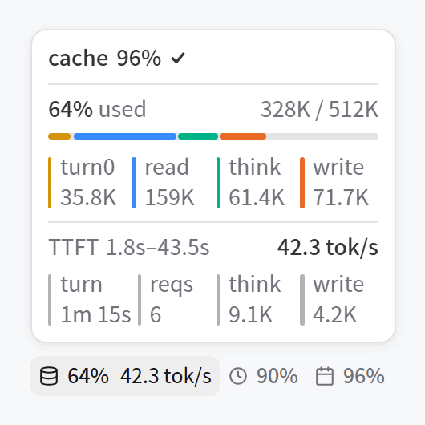

  距上一轮满 3 分钟变黄并显示倒计时（~1m），满 4 分钟变红。按时间在本地估算，实际命中以服务端为准。

- **占用预警**：上下文快满时，胶囊数字变黄、变红；开新对话后恢复正常。

  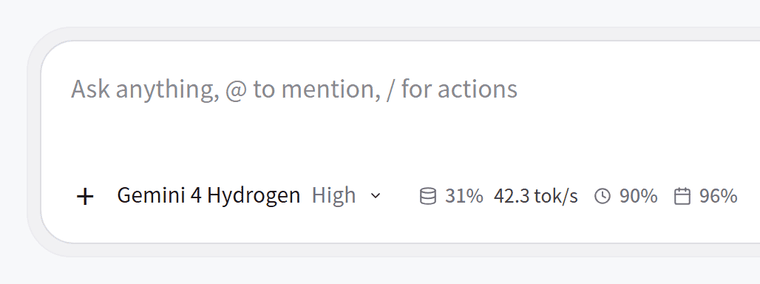

  75% 变黄，90% 及以上变红。

- **生成速度与动效**：显示最近一次请求的速度；开启动效后，生成时小圆点呼吸，停下后保持颜色一会儿再变灰。

  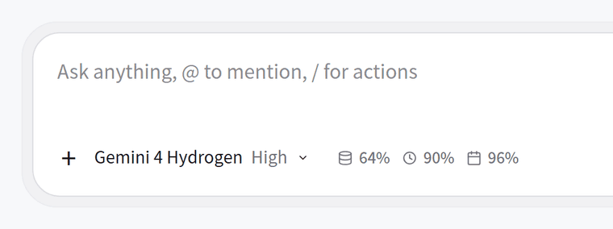

  首个请求完成前显示 —。圆点颜色：低于 10 tok/s 红色，10 至 25 黄色，25 及以上绿色；停止后保色 15 秒再变灰。动效默认关闭。

## 上下文面板

悬停或点击上下文胶囊打开：上下文被什么占满、最近一次请求和本轮各花了多少。

上限按当前会话和模型实时读取（如 256K／512K），首轮之前显示 0 / --。四类组成：turn0 首轮、read 读取、think 思考、write 写入。口径见<a href="#数据口径">数据口径</a>。

- **竖列或横条，方块或圆点**：上下文明细和本轮统计各自可选；横条模式下标记可选方块或圆点。

  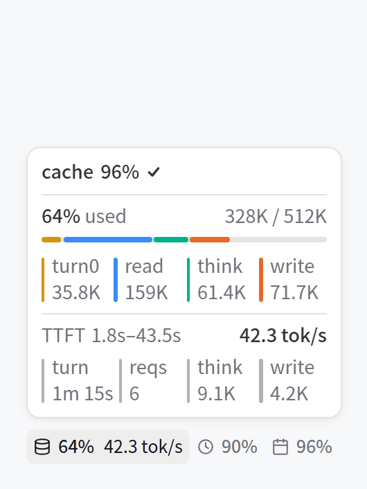

- **竖列显示哪些字段**：名称、数值、百分比逐项开关，顺序可调（操作见[设置](#设置)）。

  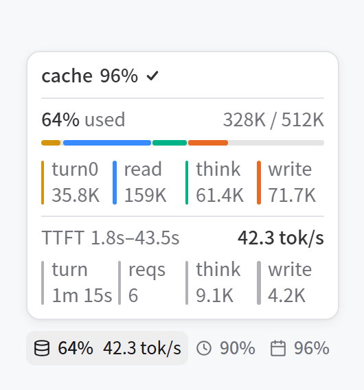

- **大小写**：全小写或首字母大写，所有面板一起变。

  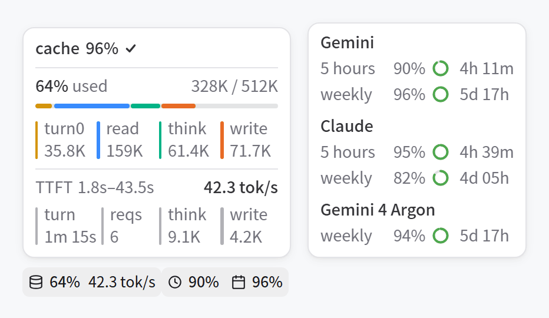

- **间距**：紧凑、标准、舒展三档。

  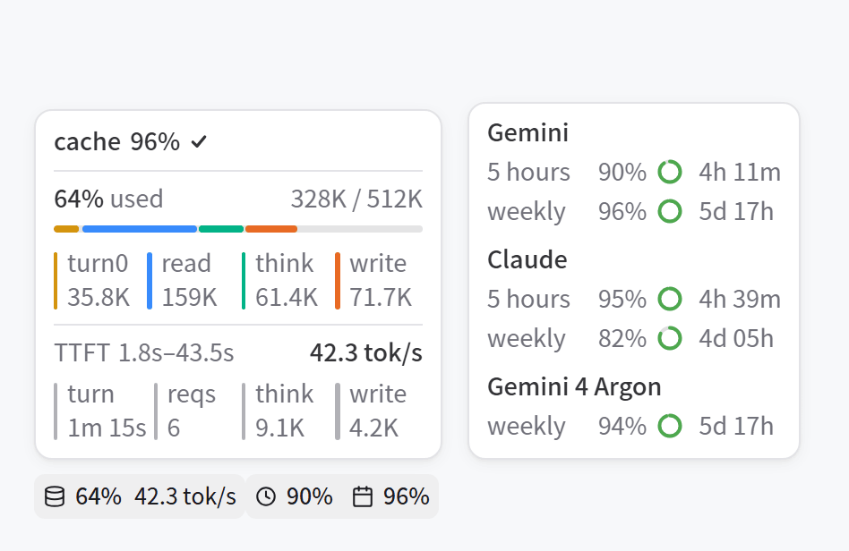

- **面板高度**：自然高度按内容决定；对齐高度让所有面板等高，切换时不会跳动。

  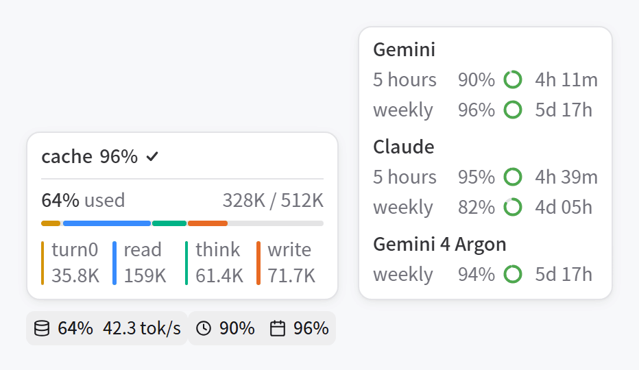

## 配额胶囊与面板

胶囊显示当前模型的 5 小时和每周剩余额度；面板列出所有额度池的剩余额度和重置倒计时。

胶囊自动跟随底栏当前选中的模型。悬停面板某一行可看到具体的重置日期、时间和时区。可选在面板中标出当前模型所在的额度池。

- **隐藏闲置窗口**：某个额度池只有每周额度时（如下图的 Argon），隐藏胶囊里空着的 5 小时占位。

  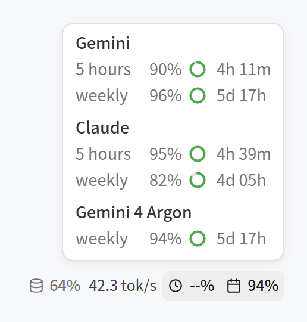

  真实的 0% 不会被隐藏；两项都未知时仍显示占位。默认关闭。

- **圆环或进度条**：

  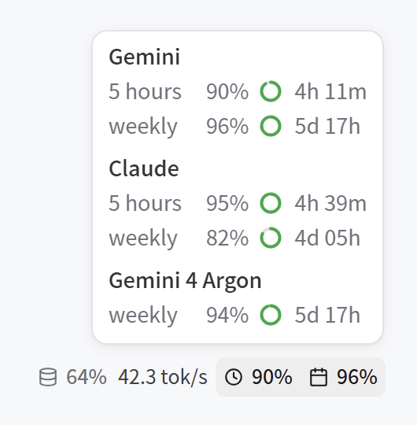

## 报错胶囊

请求失败时才出现，直接告诉你原因，不用翻日志。

- **六种错误**：额度耗尽、限流（429）、断连、验证异常、服务繁忙、未知原因，面板附说明和原始报错。

  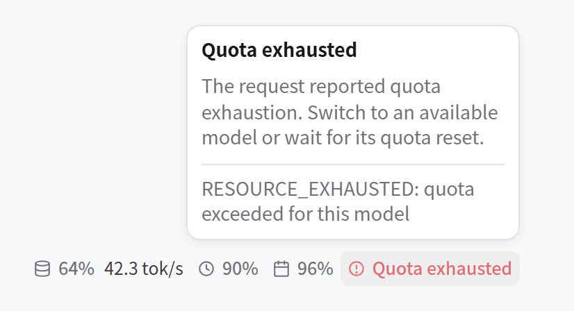

  你主动停止生成不算失败，不显示。上下文超限归到占用预警，不在这里重复提示。可在设置中关闭。

## 多语言

- **三种显示语言**：English、简体中文、繁體中文，所有面板一起切换。

  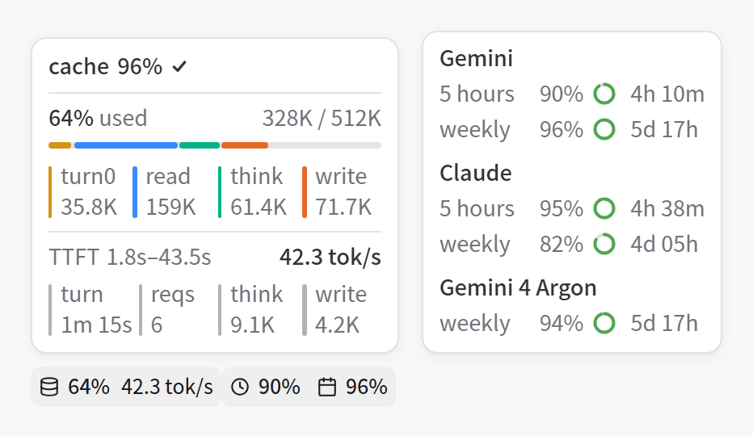

- **本地化倒计时**：重置倒计时可用紧凑格式（4h 11m），或跟随显示语言（4 hr 11 min、4小时11分、4小時11分）。

  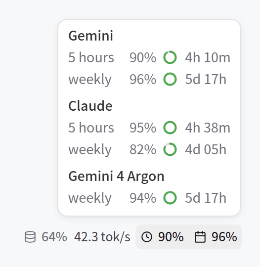

  设置页本身的语言单独选择，默认简体中文。数字和倒计时标记为不翻译，网页翻译插件不会把它们改乱。

## 其他

- **点击固定**：点一下胶囊，面板就留着不消失；再次点击、点击外部或按 Esc 关闭。
- **窄栏自动折叠**：窗口再窄也不会挤乱，最重要的信息留到最后。

  

  先把 Turbo 选择器收成图标，再逐级收起速度、报错文字、配额数字并压缩模型名，尽量保留上下文和报错入口。拉宽后自动恢复。

另外：跟随 Antigravity 明暗主题；面板会尽量靠近自己的胶囊，窄栏时留在输入框内不被裁掉；通过原生 Sidecar 和 CDP 挂载、样式隔离在 Shadow DOM 里，不改客户端，升级后照常使用。

## 设置

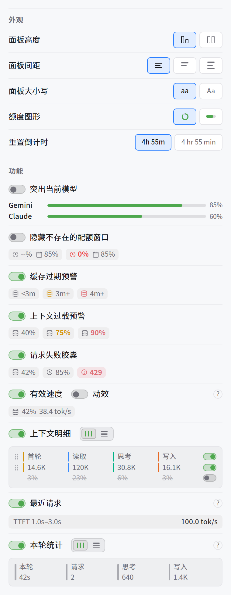

在对话顶部 **… → Extensions → agy-capsule** 打开侧栏，顶部切换“统计”和“设置”两页。

| 设置 | 默认 | 作用 |
|---|---|---|
| 显示语言 | English | 底栏面板和侧栏统计的语言 |
| 设置语言 | 简体中文 | 设置页本身的语言 |
| 突出当前模型 | 关 | 在配额面板标出当前模型所在分组 |
| 隐藏不存在的配额窗口 | 关 | 只有 5h 或只有每周数据时，隐藏另一项空占位 |
| 缓存过期预警 | 开 | 3 分钟变黄、4 分钟变红 |
| 上下文过载预警 | 开 | 占用 75% 变黄、90% 变红 |
| 请求失败胶囊 | 开 | 请求失败时显示第三个胶囊 |
| 有效速度 ／ 动效 | 开 ／ 关 | 底栏显示速度；动效让小圆点在生成时呼吸 |
| 上下文明细 | 开 | 上下文面板里的四类组成 |
| 最近请求 | 开 | 速度、TTFT 和请求耗时 |
| 本轮统计 | 开 | 本轮耗时、请求数、思考和写入 |

 

竖列字段在预览里直接编辑：点右侧开关显示或隐藏一行，隐藏的行变灰并沉到底部；拖动左侧手柄调整顺序。

  

设置保存在 <code>~/.gemini/config/agy-capsule/settings.json</code>（Windows 为 <code>%USERPROFILE%\.gemini\config\agy-capsule\settings.json</code>），更新和卸载插件都不会覆盖；旧版本留下的文件缺少新选项时自动使用默认值。

## 安装

1. 下载或拉取仓库后，运行对应脚本：

   | 操作 | Windows | macOS / Linux |
   |---|---|---|
   | 安装 | `install.bat` | `sh install.sh` |
   | 更新 | `update.bat`（先拉取新版代码） | `sh update.sh`（先拉取新版代码） |
   | 卸载 | `uninstall.bat` | `sh uninstall.sh` |

   安装／更新会同步到 <code>~/.gemini/config/plugins/agy-capsule</code>（Windows 为 <code>%USERPROFILE%\.gemini\config\plugins\agy-capsule</code>），同时移除旧版残留文件。卸载只删除插件目录，保留设置。
2. 在 Antigravity 的 **Plugins** 面板启用 **agy-capsule**。
3. 在对话顶部的 **… → Extensions → agy-capsule** 打开侧栏。

字体优先使用思源黑体，未安装时使用系统字体，不需要额外下载。

### 自动重载

运行中的插件每秒检查安装目录内的代码／配置变化，文件稳定约 1.5 秒后清理注入并退出，由 AGY 自动重启并重新连接已打开的侧栏。脚本复制期间不会触发重启。不重启 AGY，不重新发送聊天请求，也不会自动从仓库复制文件。

从尚不支持自动重载的旧版首次更新时，需手动重启插件一次。卸载后若页面仍留有旧 UI，重载该页面即可；脚本不修改宿主安装文件。仍可手动复制 [`agy-capsule`](./agy-capsule) 文件夹安装。

## 数据口径

- **有效速度** = 总输出 ÷（TTFT + 生成耗时），包含等待首 token 的时间，不是纯生成速率。
- **最近请求**只看最近一次模型请求，不是整轮；缺失的数据显示 `—`，不拿旧请求补。
- **本轮统计**从你最近一条消息开始累计，耗时包含排队、等待和工具执行。
- **缓存过期**是按时间本地估算的，不代表服务端真实命中情况。

详细说明

#### 最近请求

- **范围**：最近一条模型请求的 metadata，不是整个用户回合；未上报的数据显示 `—`，不沿用旧请求补齐。
- **输出**：`usage.outputTokens` 是总输出，等于 `responseOutputTokens + thinkingOutputTokens`。回复部分包含模型生成的工具调用；四类上下文统计仍沿用原来的回复／思考分项，不重复累计总输出。
- **TTFT／耗时**：分别读取 AGY 记录的 `timeToFirstToken`、`streamingDuration`；请求耗时为两者之和，不包含工具执行及整轮任务的累计时间。TTFT 的具体计时起点、测量来源和首 token 判定边界尚未确认，不能当作纯 prefill 耗时。
- **速度**：`总输出 ÷ (TTFT + streamingDuration)`，是有效吞吐，不是纯 streaming 速率。计时不全或分母为零时不计算。
- **底栏速度**：以最近用户消息开启的一轮为范围；首个请求完成前显示 `—`，之后保留本轮最近一次已完成请求的速度。动效圆点表示本轮仍在运行（包含工具），停止后保色 15 秒再变灰；低于 10 tok/s 红色、10 至 25 黄色、25 及以上绿色。
- **核对**：本机 22 条 Gemini（Hydrogen／Argon）请求的 SQLite 计数和计时与 Language Server RPC 一致；插件不做 RPC 轮询。

#### 本轮统计

- 从最近一条已发送的用户消息开始，包含排队时间；新消息重新累计。
- 请求数包含已记录的重试，排除纯预检和注入回复，不用步骤数代替；不保证覆盖未记录的后端调用。
- 思考与写入按每次请求上报的用量累计。写入是回复／工具调用指令，不含思考或工具返回内容，与四类上下文中的 write 不同。
- 耗时用首尾时间相减，包含等待和工具，不累加请求耗时。运行中本地计时，结束后固定；取消时缺少明确时间则显示未知。
- 用量缺失时对应总数显示 `—`，悬停可看已上报部分，不把未知当 0。没有用户消息时隐藏整个区块。

#### Cache

- Cache 行显示缓存输入占总输入的比例，以及最近一次记录距今多久（`<1m`、`5m`、`1h 5m`）。时间来自步骤记录，不是缓存剩余寿命。

#### 实现

- 数据库按 DB＋WAL 变化复用读取结果；页面代码只安装一次，数据变化才推送，本地时钟继续刷新。
- 原生 Turbo 和模型名的折叠只用限定在底栏内的运行时样式，不修改宿主文件或按钮功能。

## 声明

- 本版参考了 [z21100644 的 PR #1](https://github.com/Lumidarin/agy-capsule/pull/1) 中的多语言、部分面板视觉设计、当前模型高亮、点击固定、生成指标与速度动效、Cache 和配额悬浮说明、占用预警与错误分类、缺失配额窗口隐藏，以及样式隔离、读取缓存、CDP 增量推送和安装维护方面的思路，逐项选择后重新实现，未整体合并。显示与设置语言分离、独立外观控制、第三失败胶囊、折叠优先级、本轮统计及后续 Sidebar 交互为本版另行设计。七类上下文估算和附件扫描未采纳。
- 配额面板在网页翻译插件下溢出的问题由 [Krwaby123 的 PR #2](https://github.com/Lumidarin/agy-capsule/pull/2) 报告并给出修复思路；本版改用列对齐与不翻译标记实现，未直接合并该 PR。
- README 中的图片和动图由插件真实代码配合演示数据渲染，不是实际会话数据。
- 目前仅在 **Windows** 上完成测试，欢迎在 **macOS** 上测试并反馈问题或提交 PR。

## License

[MIT](./LICENSE)
