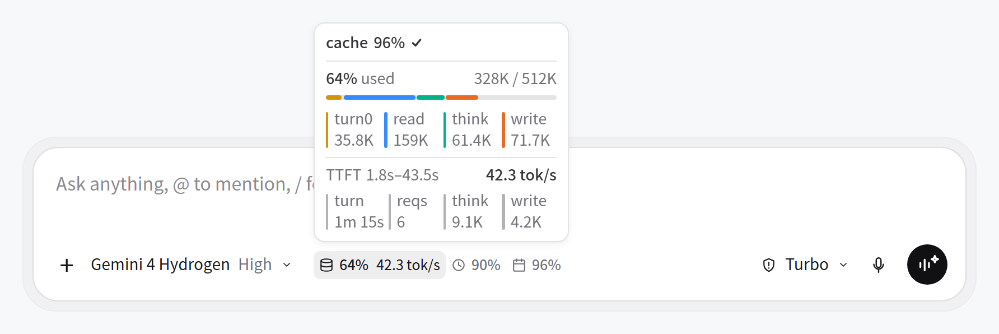
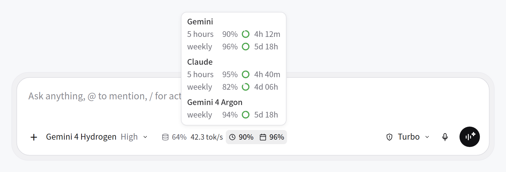
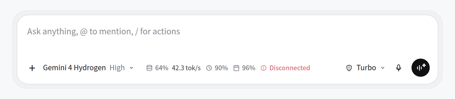
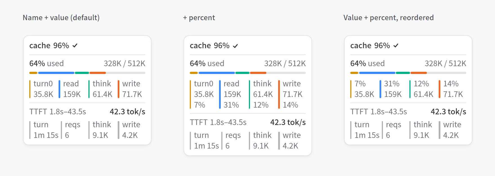
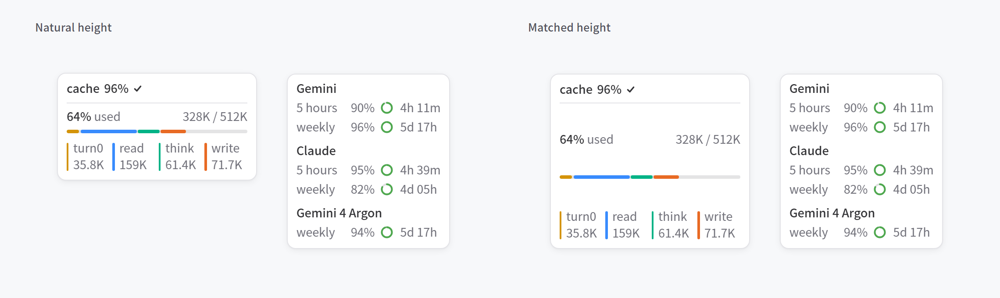
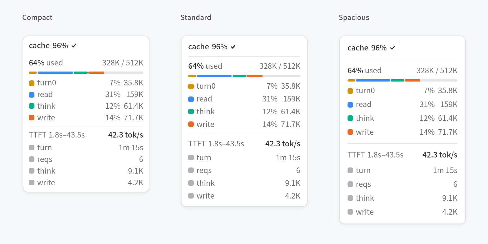
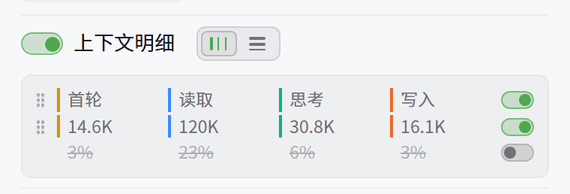

# agy-capsule

**中文** | [English](./README.en.md)

在 Antigravity 输入框底栏显示上下文占用、多模型配额、缓存状态和生成速度，悬停胶囊即可查看详情。

  

- [功能](#功能)
- [外观](#外观)
- [设置](#设置)
- [安装](#安装)
- [数据口径](#数据口径)
- [声明](#声明)

## 功能

### 上下文与生成指标

- **占用比例**：按当前会话和模型读取真实上下文上限（如 `256K` / `512K`），首轮之前显示 `0 / --`。
- **四类组成**：`turn0`（首轮）、`read`（读取）、`think`（思考）、`write`（写入）各占多少。
- **最近请求**：有效速度、首 token 等待（TTFT）和请求耗时；底栏胶囊里也会显示速度。
- **本轮统计**：从你最近一条消息起，本轮用了多久、发了几次请求、思考和写入了多少。

### 多模型配额

自动匹配底栏当前选中的模型，胶囊显示它的 5 小时和每周剩余配额。面板列出所有分组的剩余比例与重置倒计时，悬停某一行可看到具体的重置日期、时间和时区。

### 缓存过期提醒

距上一轮满 3 分钟时，Cache 变黄并显示倒计时（`~1m`）；满 4 分钟变红，提示缓存可能已过期。这是按时间在本地估算的，实际命中以服务端为准。

### 请求失败提示

请求失败时，底栏多出第三个胶囊，标明是额度耗尽、429 限流、断连、验证异常、服务繁忙还是未知原因；面板里有说明和原始报错。你主动停止生成不算失败，不会显示。

### 窄栏自动折叠

输入框变窄时，先把 Turbo 选择器收成图标，再逐级收起速度、失败文字、配额数字并压缩模型名，尽量保留上下文和失败入口。拉宽后自动恢复。

### 其他

- **点击固定**：点击胶囊固定面板；再次点击、点击外部或按 `Esc` 关闭。
- **面板就近对齐**：上下文面板贴着底栏左边；配额和失败面板在盖住自身胶囊的前提下尽量往左靠；窄栏时面板留在输入框内，不被裁掉。
- **预警着色**（可关）：上下文占用到 75% 胶囊数字变黄，90% 及以上变红。
- **跟随明暗主题**：直接使用 Antigravity 自身的配色变量。
- **不怕网页翻译插件**：数字和倒计时标记为不翻译，不会被改写后错位。
- **不改客户端**：通过原生 Sidecar 和 CDP 挂载，样式隔离在 Shadow DOM 里，客户端升级后照常使用。

## 外观

以下选项互相独立，都在侧栏“设置”页里切换，改完立即生效，下方实时预览。

### 明细布局：竖列或横条

上下文明细和本轮统计各自选择竖列（四列并排）或横条（一行一项）。横条模式下，两处的标记（方块／圆点）也分别设置。上下文明细可以整体关闭。

### 竖列显示哪些字段

竖列模式下，名称、数值、百分比可以逐项开关，顺序也可以拖动调整（操作见[设置](#设置)）。

### 配额面板：图形、倒计时与语言

- **额度图形**：圆环或进度条。
- **重置倒计时**：紧凑（`4h 55m`）或跟随显示语言的本地化格式（`4 hr 55 min`、`4小时55分`）。
- **面板大小写**：全小写（`weekly`）或首字母大写（`Weekly`）。
- **显示语言**：English、简体中文、繁體中文。

### 面板高度

自然高度：每个面板按内容决定高度。对齐高度：上下文、配额和失败面板等高，切换时不会跳动。

### 面板间距

紧凑、标准、舒展三档。

## 设置

在对话顶部 **… → Extensions → agy-capsule** 打开侧栏，顶部切换“统计”和“设置”两页。

| 设置 | 默认 | 作用 |
|---|---|---|
| 显示语言 | English | 底栏面板和侧栏统计的语言 |
| 设置语言 | 简体中文 | 设置页本身的语言 |
| 突出当前模型 | 关 | 在配额面板标出当前模型所在分组 |
| 隐藏不存在的配额窗口 | 关 | 只有 5h 或只有每周数据时，隐藏另一项空占位 |
| 缓存过期预警 | 开 | 3 分钟变黄、4 分钟变红 |
| 上下文过载预警 | 开 | 占用 75% 变黄、90% 变红 |
| 请求失败胶囊 | 开 | 请求失败时显示第三个胶囊 |
| 有效速度 ／ 动效 | 开 ／ 关 | 底栏显示速度；动效让小圆点在生成时呼吸 |
| 上下文明细 | 开 | 上下文面板里的四类组成 |
| 最近请求 | 开 | 速度、TTFT 和请求耗时 |
| 本轮统计 | 开 | 本轮耗时、请求数、思考和写入 |

 

竖列字段在预览里直接编辑：点右侧开关显示或隐藏一行，隐藏的行变灰并沉到底部；拖动左侧手柄调整顺序。

  

设置保存在 `~/.gemini/config/agy-capsule/settings.json`（Windows 为 `%USERPROFILE%\.gemini\config\agy-capsule\settings.json`），更新和卸载插件都不会覆盖；旧版本留下的文件缺少新选项时自动使用默认值。

## 安装

1. 下载或拉取仓库后，运行对应脚本：

   | 操作 | Windows | macOS / Linux |
   |---|---|---|
   | 安装 | `install.bat` | `sh install.sh` |
   | 更新 | `update.bat`（先拉取新版代码） | `sh update.sh`（先拉取新版代码） |
   | 卸载 | `uninstall.bat` | `sh uninstall.sh` |

   安装／更新会同步到 `~/.gemini/config/plugins/agy-capsule`（Windows 为 `%USERPROFILE%\.gemini\config\plugins\agy-capsule`），同时移除旧版残留文件。卸载只删除插件目录，保留设置。
2. 在 Antigravity 的 **Plugins** 面板启用 **agy-capsule**。
3. 在对话顶部的 **… → Extensions → agy-capsule** 打开侧栏。

字体优先使用思源黑体，未安装时使用系统字体，不需要额外下载。

### 自动重载

运行中的插件每秒检查安装目录内的代码／配置变化，文件稳定约 1.5 秒后清理注入并退出，由 AGY 自动重启并重新连接已打开的侧栏。脚本复制期间不会触发重启。不重启 AGY，不重新发送聊天请求，也不会自动从仓库复制文件。

从尚不支持自动重载的旧版首次更新时，需手动重启插件一次。卸载后若页面仍留有旧 UI，重载该页面即可；脚本不修改宿主安装文件。仍可手动复制 [`agy-capsule`](./agy-capsule) 文件夹安装。

## 数据口径

- **有效速度** = 总输出 ÷（TTFT + 生成耗时），包含等待首 token 的时间，不是纯生成速率。
- **最近请求**只看最近一次模型请求，不是整轮；缺失的数据显示 `—`，不拿旧请求补。
- **本轮统计**从你最近一条消息开始累计，耗时包含排队、等待和工具执行。
- **缓存过期**是按时间本地估算的，不代表服务端真实命中情况。

详细说明

#### 最近请求

- **范围**：最近一条模型请求的 metadata，不是整个用户回合；未上报的数据显示 `—`，不沿用旧请求补齐。
- **输出**：`usage.outputTokens` 是总输出，等于 `responseOutputTokens + thinkingOutputTokens`。回复部分包含模型生成的工具调用；四类上下文统计仍沿用原来的回复／思考分项，不重复累计总输出。
- **TTFT／耗时**：分别读取 AGY 记录的 `timeToFirstToken`、`streamingDuration`；请求耗时为两者之和，不包含工具执行及整轮任务的累计时间。TTFT 的具体计时起点、测量来源和首 token 判定边界尚未确认，不能当作纯 prefill 耗时。
- **速度**：`总输出 ÷ (TTFT + streamingDuration)`，是有效吞吐，不是纯 streaming 速率。计时不全或分母为零时不计算。
- **底栏速度**：以最近用户消息开启的一轮为范围；首个请求完成前显示 `—`，之后保留本轮最近一次已完成请求的速度。动效圆点表示本轮仍在运行（包含工具），停止后保色 15 秒再变灰；低于 10 tok/s 红色、10 至 25 黄色、25 及以上绿色。
- **核对**：本机 22 条 Gemini（Hydrogen／Argon）请求的 SQLite 计数和计时与 Language Server RPC 一致；插件不做 RPC 轮询。

#### 本轮统计

- 从最近一条已发送的用户消息开始，包含排队时间；新消息重新累计。
- 请求数包含已记录的重试，排除纯预检和注入回复，不用步骤数代替；不保证覆盖未记录的后端调用。
- 思考与写入按每次请求上报的用量累计。写入是回复／工具调用指令，不含思考或工具返回内容，与四类上下文中的 write 不同。
- 耗时用首尾时间相减，包含等待和工具，不累加请求耗时。运行中本地计时，结束后固定；取消时缺少明确时间则显示未知。
- 用量缺失时对应总数显示 `—`，悬停可看已上报部分，不把未知当 0。没有用户消息时隐藏整个区块。

#### Cache

- Cache 行显示缓存输入占总输入的比例，以及最近一次记录距今多久（`<1m`、`5m`、`1h 5m`）。时间来自步骤记录，不是缓存剩余寿命。

#### 实现

- 数据库按 DB＋WAL 变化复用读取结果；页面代码只安装一次，数据变化才推送，本地时钟继续刷新。
- 原生 Turbo 和模型名的折叠只用限定在底栏内的运行时样式，不修改宿主文件或按钮功能。

## 声明

- 本版参考了 [z21100644 的 PR #1](https://github.com/Lumidarin/agy-capsule/pull/1) 中的多语言、部分面板视觉设计、当前模型高亮、点击固定、生成指标与速度动效、Cache 和配额悬浮说明、占用预警与错误分类、缺失配额窗口隐藏，以及样式隔离、读取缓存、CDP 增量推送和安装维护方面的思路，逐项选择后重新实现，未整体合并。显示与设置语言分离、独立外观控制、第三失败胶囊、折叠优先级、本轮统计及后续 Sidebar 交互为本版另行设计。七类上下文估算和附件扫描未采纳。
- 配额面板在网页翻译插件下溢出的问题由 [Krwaby123 的 PR #2](https://github.com/Lumidarin/agy-capsule/pull/2) 报告并给出修复思路；本版改用列对齐与不翻译标记实现，未直接合并该 PR。
- README 中的图片和动图由插件真实代码配合演示数据渲染，不是实际会话数据。
- 目前仅在 **Windows** 上完成测试，欢迎在 **macOS** 上测试并反馈问题或提交 PR。

## License

[MIT](./LICENSE)
