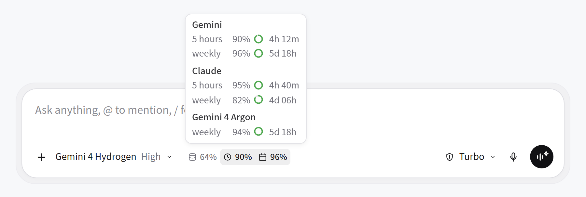
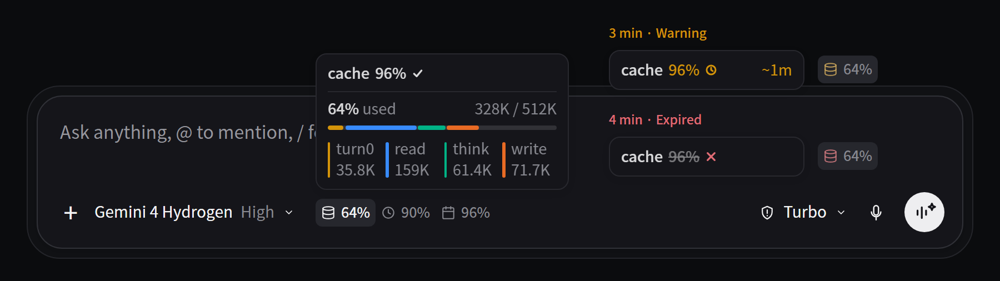

# agy-capsule

**中文** | [English](./README.en.md)

Antigravity 输入框底栏的上下文与配额胶囊。

  

  

## 功能

- **内联双胶囊**：嵌入输入框底栏，按当前会话与模型动态读取真实上下文上限（如 `256k` / `512k`，未发起首轮前显示 `0 / --`），实时显示 Context 占比与 5h / Weekly 剩余配额。
- **Token 构成明细**：悬停查看 `Turn0`、`Read`、`Think`、`Write` 分段占比与 Token 用量。
- **Sidebar 显示设置**：顶部切换统计／设置页，选择显示语言（English／简体／繁体，默认 English）、独立外观选项及是否突出当前模型。设置语言独立选择，默认简中；主题固定跟随应用。默认紧凑间距、圆环与方块标记、不突出模型；设置即时保存，四类统计口径不变。每个功能开关旁直接放样式选项，下方实时预览所选效果。
- **明细布局可选**：上下文明细可整体关闭；开启时可选竖列（四列并排）或横条（GitHub 式一行一项），本轮统计单独选择。横条模式下上下文与本轮的标记（方块／圆点）分别设置。竖列可在预览里逐项开关名称、数值、百分比，拖动调整顺序；隐藏项变灰并沉到底部。
- **点击固定弹窗**：点击胶囊可固定查看，并保持胶囊选中底色；再次点击、点击外部或按 `Esc` 关闭。原有悬停查看照常可用。
- **弹窗就近对齐**：上下文面板与底栏左对齐；配额与异常面板在盖住各自胶囊右端的前提下尽量向左靠拢。开启“对齐高度”时，异常面板也与另两个面板等高。底栏较窄时，弹窗会收进输入框可见范围内，不被裁掉。
- **生成指标**：胶囊、上下文弹窗和 sidebar 统计区显示最近一次模型请求的有效速率；详情包含 TTFT、记录耗时、总输出及回复/思考拆分、会话 steps。数字统一为一位小数大写 `K` / `M`，不足 1,000 的 token 保留整数。Sidebar 可独立开启“速度呼吸与冷却”，默认关闭：底栏小圆点呼吸，停止后保色 15 秒再变灰；低于 10 tok/s 红色、10 至低于 25 黄色、25 及以上绿色，不改变速度计算或 Cache 状态。
- **缓存过期提醒**：距上一轮满 3 分钟变黄倒计时（`~1m`），满 4 分钟变红标记 `Cache` 过期。
- **Cache 悬浮说明**：底栏与 sidebar 的 Cache 行显示缓存输入／总输入及最近记录距今，使用 `<1m`、`5m`、`1h 5m` 等格式；底栏打开面板时立即更新。时间来自步骤记录，不是缓存剩余寿命；3／4 分钟为原有提醒阈值。
- **明细 tooltip**：总占用与进度条显示剩余空间、缓存／非缓存输入；四类统计行解释实际口径；配额行补充具体重置日期时间与本地时区。底栏和 sidebar 共用文案，不引入七类估算或附件扫描。
- **多模型配额面板**：自动匹配底栏当前模型（如 `Gemini`、`Claude`、`Argon`、`Carbon`），悬停查看各分组 5h 与周配额剩余比例及重置倒计时。百分比与进度条按列对齐；倒计时可选紧凑（`4h 55m`）或本地化（`4小时55分`）格式。数字与倒计时标记为不翻译，避免网页翻译插件改写后错位。
- **可选隐藏空配额窗口**：Sidebar 可开启“隐藏不存在的配额窗口”，默认关闭。仅有 Weekly 或 5h 数据时，隐藏底栏胶囊中另一项的空占位；真实 0% 保留，两项都未知时仍显示占位。
- **上下文黄／红预警**：独立开关，默认开启；仅胶囊百分比在 75% 时标黄、90% 及以上标红，100%+ 同样处理。图标与面板行保留缓存状态配色，不自动弹窗或新增警告条。
- **请求失败第三胶囊**：独立开关，默认开启。显示额度耗尽、429、断连、验证异常、服务繁忙或“未知原因”；用户取消不显示，超限归高占用变色。详情 hover／点击查看，窄栏可收为图标，不替换原上下文百分比。
- **窄屏自适应折叠**：先把 Turbo 原生选择器收成盾牌，再逐级隐藏速度、配额窗口及数字、压缩模型名；优先保留上下文／异常入口。Turbo 使用插件运行时样式，不改宿主安装文件或按钮功能。
- **本地字体回退**：优先使用思源黑体，未安装时使用系统 UI 字体；不下载字体，也不要求额外安装。
- **昼夜自适应 & 跨版本兼容**：直接复用宿主 CSS 变量；通过原生 Sidecar 与 CDP 挂载，不改客户端源码，客户端升级后直接使用。

## 生成指标口径

外观可独立选择自然／对齐高度、紧凑／标准／舒展密度、面板大小写、圆环／进度条额度图形、重置倒计时格式，以及上下文明细和本轮统计各自的竖列／横条布局与标记。Sidebar 与网页共用这些单项设置；不提供预设管理或导入／导出功能。

胶囊与弹窗使用 Shadow DOM 隔离样式；原生 Turbo／模型名折叠只保留限定底栏的运行时样式。数据库按 DB＋WAL 变化复用读取结果，页面代码一次安装、数据变化才推送，本地时钟继续刷新；不包含七类估算或附件扫描。

底栏速度以最近用户消息开启的一轮为范围：首个请求完成且有有效数据前显示 `—`，之后保留本轮最近一次已完成请求的速度，后续请求完成时更新。圆点表示本轮运行（包含工具），数字不是实时速度或整轮平均值；弹窗／sidebar 的四项指标仍按以下请求口径显示。

最近一次模型请求的有效速度、总输出、首 token 等待、请求耗时各占一行，四个开关默认开启。本轮统计也有独立分组和总开关；不提供步骤记录数或高级区。设置与面板统一名称，不在设置行内放静态示例数字；只保留原有 tooltip，不添加常驻说明小字。有效速度开关同时控制胶囊内的速率；“速度动效”是默认关闭的子选项。原“生成详情”开关的选择会保留到剩余三项详情中。

- **范围**：最近一条模型请求 metadata，不是整个用户回合；未上报的数据显示 `—`，不沿用旧请求补齐。
- **输出**：`usage.outputTokens` 是总输出，等于 `responseOutputTokens + thinkingOutputTokens`。回复部分包含模型生成的工具调用；原四类上下文统计仍沿用原来的回复/思考分项，不重复累计总输出。
- **TTFT / 耗时**：分别读取 AGY 记录的 `timeToFirstToken`、`streamingDuration`；详情中的耗时为两者之和，不包含工具执行及整轮任务的累计时间。TTFT 的具体计时起点、测量来源和首 token 判定边界尚未确认，不能当作纯 prefill 耗时。
- **速度**：`总输出 ÷ (TTFT + streamingDuration)`，包含 TTFT 等待阶段，是有效吞吐，不是纯 streaming 速率。计时不全或分母为零时不计算。
- **核对**：本机 22 条 Gemini（Hydrogen / Argon）请求的 SQLite 计数和计时与 Language Server RPC 一致；本次未增加 RPC 轮询。

### 本轮统计（Turn metrics）

上下文弹窗和 Sidebar 增加独立“本轮”区块：模型请求数、读取 R、写入 W、思考与整轮耗时。总开关默认开启，保留原有最近请求指标，底栏速度口径不变。

- 从最近一条已发送的用户消息开始，包含排队时间；新消息重新累计。
- 请求数包含已记录重试，排除纯预检和注入回复，不用步骤数代替；不保证未记录的后端调用也被覆盖。
- R 是每次尝试的缓存＋非缓存输入累计，重复输入的历史重复计数。W 是回复／工具调用指令，不含 Think 或工具返回；与原四类上下文中的 R／W 不同。
- 耗时使用首尾时间相减，包含等待和工具，不累加请求耗时。运行中本地计时，结束后固定；取消缺少明确时间时显示未知。
- 用量缺失时对应总数显示 `—`，hover 可查看已上报部分，不将未知当 0。没有用户消息时隐藏整个区块。

## 安装

1. 下载或拉取仓库后，运行对应脚本：

   | 操作 | Windows | macOS / Linux |
   |---|---|---|
   | 安装 | `install.bat` | `sh install.sh` |
   | 更新 | `update.bat`（先拉取新版代码） | `sh update.sh`（先拉取新版代码） |
   | 卸载 | `uninstall.bat` | `sh uninstall.sh` |

   安装／更新会同步到 `~/.gemini/config/plugins/agy-capsule`（Windows 为 `%USERPROFILE%\.gemini\config\plugins\agy-capsule`），同时移除旧版残留文件。卸载只删除插件目录，保留设置。
2. 在 Antigravity 的 **Plugins** 面板启用 **agy-capsule**。
3. 在对话顶部的 **… → Extensions → agy-capsule** 打开侧栏；侧栏顶部可在“统计”和“设置”两页之间切换。

### 自动重载

运行中的插件每秒检查安装目录内的代码／配置变化，文件稳定约 1.5 秒后清理注入并退出，由 AGY 自动重启并重新连接已打开的 Sidebar。脚本复制期间不会触发重启。不重启 AGY，不重新发送聊天请求，也不会自动从仓库复制文件。

从尚不支持自动重载的旧版首次更新时，需手动重启插件一次。卸载后若页面仍留有旧 UI，重载该页面即可；脚本不修改宿主安装文件。仍可手动复制 [`agy-capsule`](./agy-capsule) 文件夹安装。

## 声明

- 显示设置保存在 `~/.gemini/config/agy-capsule/settings.json`（Windows 为 `%USERPROFILE%\.gemini\config\agy-capsule\settings.json`），更新和卸载插件都不会覆盖；旧文件缺少的新选项自动使用默认值。
- 本版很多功能参考了 [z21100644 的 PR #1](https://github.com/Lumidarin/agy-capsule/pull/1)，逐项挑选后重新实现，未整体合并：显示／设置语言分离与繁体中文、独立外观选项（对齐高度、密度、额度图形、标记）、突出当前模型、点击固定弹窗、有效速度与速度动效、请求指标、Cache 悬浮说明、数字格式统一、明细 tooltip、上下文预警与请求失败胶囊、隐藏空配额窗口、窄栏折叠、Shadow DOM 隔离、数据读取缓存、CDP 推送优化，以及安装／更新／卸载脚本与自动重载。七类上下文估算和附件扫描未采纳。
- 配额面板在网页翻译插件下溢出的问题由 [Krwaby123 的 PR #2](https://github.com/Lumidarin/agy-capsule/pull/2) 报告并给出修复思路；本版改用列对齐与不翻译标记实现，未直接合并该 PR。

- **缓存过期提示仅供参考**：缓存状态（3 分钟预警 / 4 分钟过期）系根据距上一轮对话的时间间隔本地估算，实际命中情况以服务端为准。
- **测试环境与反馈**：目前仅在 **Windows** 环境下完成测试，欢迎在 **macOS** 环境下测试并反馈问题或提交 PR。

## License

[MIT](./LICENSE)
